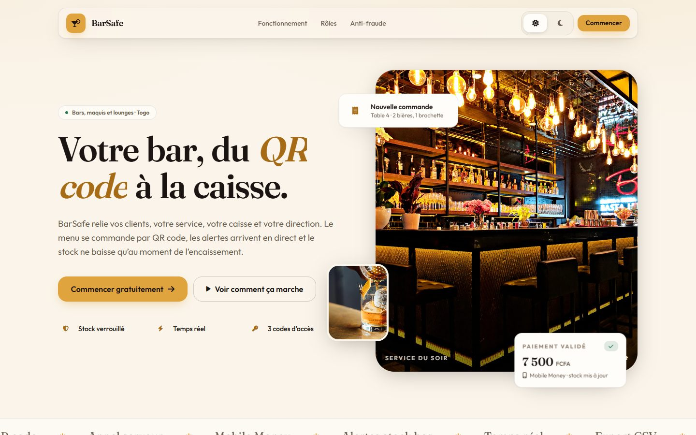
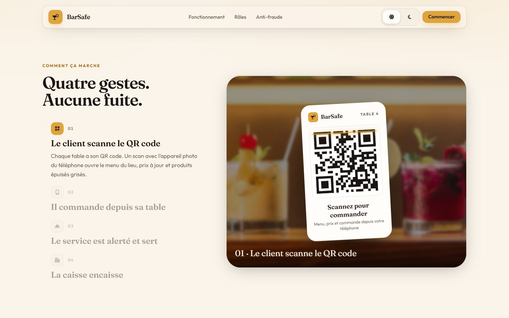

<div align="center">
  
  
  <h1 align="center">🍸 BarSafe Togo</h1>
  <p align="center">
    <strong>La solution SaaS Full-Stack de gestion de bars, restaurants et espaces lounge.</strong>
    <br />
    <em>Transparence financière, gestion des stocks en temps réel et expérience client digitale.</em>
  </p>
</div>

---

## 🌟 Présentation du Projet

**BarSafe** est une application web moderne (SaaS) conçue pour révolutionner la gestion des établissements de nuit et de restauration. Faisant face aux problèmes récurrents de pertes d'inventaire, de fraudes à la caisse et d'inefficacité du service, BarSafe propose un écosystème logiciel complet reliant les clients, les serveurs, les caissiers et la direction via une interface fluide et hautement sécurisée.

Grâce à une architecture Cloud-Native robuste, cette application illustre des compétences avancées en ingénierie logicielle, gestion de bases de données sécurisées et design d'interface utilisateur (UI/UX) premium.

## 🚀 Fonctionnalités Clés par Profil

Le système est divisé en plusieurs accès sécurisés selon le rôle de l'utilisateur :

- **👑 L'Espace Patron (Direction)**
  - **Tableau de bord Analytique :** Chiffre d'affaires en temps réel, alertes de stock bas, top des ventes.
  - **Gestion du Catalogue :** Ajout de produits, paramétrage des prix et gestion dynamique de l'inventaire.
  - **Accès équipe :** trois codes numériques par établissement (Direction, Service, Caisse), hachés en base. Pas de compte e-mail à créer.
  - **Générateur de QR Code :** Création des QR Codes pour la numérisation des tables.

- **🏃 L'Espace Serveur**
  - Prise de commandes numérisée directement à la table.
  - Réception de notifications en temps réel (Appel serveur, nouvelle commande).
  - Suivi des statuts de commandes (En préparation, Servi).

- **💳 L'Espace Caissier**
  - Validation financière sécurisée des commandes.
  - Déduction automatique des stocks lors du paiement, inhibant tout écart d'inventaire.

- **📱 L'Expérience Client (Menu Digital)**
  - Scan de QR code redirigeant vers le menu du bar.
  - Interface e-commerce pour commander depuis son smartphone.
  - Appel direct d'un serveur autorisé depuis la table.

## 💻 Stack Technique & Architecture

BarSafe a été pensé pour la performance, la sécurité et la maintenabilité, utilisant les standards industriels actuels :

### Frontend
* **React 19 & TypeScript :** Développement par composants, typage strict pour une base de code fiable.
* **Vite.js :** Outil de build nouvelle génération pour une performance optimale.
* **TailwindCSS & Vanilla CSS :** Design System personnalisé intégrant du *Glassmorphism* premium et un mode sombre/clair (Dark Mode) natif.
* **Recharts:** Visualisation de données financières et statistiques de ventes.
* **React Router v7 :** Navigation fluide (Single Page Application) avec protection des routes par rôle.

### Backend & Cloud (BaaS)
* **Supabase (PostgreSQL) :** Base de données relationnelle hautement performante.
* **Row Level Security (RLS) :** Politiques de sécurité avancées garantissant l'étanchéité absolue des données entre différents établissements.
* **Fonctions SQL (RPC) :** toutes les écritures passent par des fonctions `SECURITY DEFINER` (`place_order`, `pay_order`, `add_stock`…) qui vérifient la session, le rôle et l'établissement.
* **Comptes (Supabase Auth, e-mail ou Google) :** compte *établissement* (crée et gère ses bars, accès Direction sans code) ou compte *client* (historique de commandes). Les clients qui scannent un QR code n'ont besoin d'aucun compte.
* **Données privées :** commandes et notifications ne sont lisibles que par le personnel connecté du bar ; un client QR ne relit que ses commandes, grâce au jeton de suivi secret reçu à la commande.
* **Sessions du personnel :** connexion par code (`staff_login`), jeton de 12 h vérifié côté serveur et conservé au rechargement de la page. Limite de 10 essais par quart d'heure.
* **Landing & animations :** Motion (entrées, micro-interactions) et GSAP ScrollTrigger (parallaxe, section épinglée, frise anti-fraude).

## 🛡️ Focus : Sécurité et Anti-Fraude
Un des défis majeurs dans la restauration est la fraude. Ce projet intègre une approche technique défensive :
* **Découplage des permissions :** Le serveur peut lancer la commande, mais seul le caissier la valide.
* **Stock Verrouillé :** Le stock ne diminue *que* lorsque la commande passe au statut "PAYÉ", une seule fois (double encaissement refusé).
* **Totaux calculés en base :** le prix vient de la table `products`, jamais du téléphone du client.
* **Écritures fermées :** la clé publique ne peut que lire ; un serveur ou un caissier n'agit que sur *son propre* établissement.

## 🛠️ Installation

```bash
npm install
cp .env.example .env.local     # renseigner VITE_SUPABASE_URL et VITE_SUPABASE_ANON_KEY (clé publishable)
npm run dev
```

Base de données (éditeur SQL Supabase, dans l'ordre) :
1. `schema.sql`
2. `supabase/migrations/20261022120000_secure_rpc_sessions.sql`
3. `supabase/migrations/20261023090000_accounts_and_private_orders.sql`
4. `supabase/migrations/20261023120000_become_owner.sql`
5. `supabase/tests/order_flow.sql` (vérification, tout est annulé à la fin)

Qualité : `npm run typecheck`, `npm run lint`, `npm test`.



## 👩🏽‍💻 À Propos de la Développeuse

**Conçu et développé par Elodie ATANA (Alias: Codorah)**

En tant que **Prompt Ingénieur** et **Développeuse Full-Stack / Intégration IA**, ma mission est de transformer des problèmes métiers complexes en solutions numériques innovantes complètes.  BarSafe est la vitrine de ma capacité à gérer un projet de A à Z : 
- Modélisation de base de données relationnelle complexe.
- Implémentation de logique métier et des politiques restrictives (RLS).
- UX/UI Engineering orienté e-commerce & tableaux de bord.

📧 **Contact :** codorah@hotmail.com  
📞 **Téléphone :** +228 71 67 25 65  
🔗 **LinkedIn :** *lien à compléter*

---
<p align="center">
  <i>Déployé et prêt pour la production.</i>
</p>
